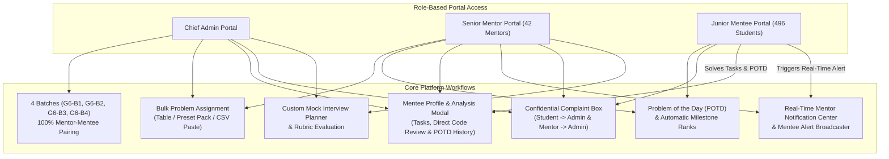

# SRU MentorHub — CSSP Student & Mentor Tracking Portal

**SRU MentorHub** is a full-stack university coding & mentorship management platform built with **Flutter (Web, Android, iOS)** and **Firebase (Authentication, Cloud Firestore, Cloud Functions)** using the **SR University Student Portal Design Language**.

It connects **Chief Admins**, **42 Senior Mentors**, and **496 Junior Mentees** across **4 Batches (`G6-B1`, `G6-B2`, `G6-B3`, `G6-B4`)** to manage daily coding challenges, bulk problem assignments, code submissions & reviews, mock interview evaluations, coding milestones, and confidential student/mentor escalations.

---

## System Architecture & Project Flow



---

## End-to-End Functional Flow by Role

### 1. Chief Admin Flow (`/admin/*`)
- **Batch & User Overview**: Monitor real-time KPIs across the 4 official batches (`G6-B1`, `G6-B2`, `G6-B3`, `G6-B4`), 42 Senior Mentors, and 496 Junior Mentees.
- **Mentors Directory & Search (`/admin/mentors`)**:
  - Search mentors by **Name, Roll Number (e.g., `2303A51408`), or Email** and filter by batch (`G6-B1` to `G6-B4`).
  - Click any mentor to inspect their assigned mentees and jump directly into any mentee's profile.
- **Students Directory & Search (`/admin/students`)**:
  - Search all 496 students by **Name, Roll Number (e.g., `2403A51282`), Branch, or Assigned Mentor**, and filter by **Batch** or **Mentor**.
- **Mentee Profile & Progress Analysis Modal**:
  - Clicking **Profile & Analysis** on any student opens a comprehensive inspection modal showing:
    1. **Identity & Coding Portfolio Links**: Roll No, Branch, Batch, Assigned Mentor, LeetCode, Codeforces, HackerRank, GitHub, LinkedIn, and Resume CV.
    2. **Progress Metrics**: Completion %, Assigned Tasks, Approved Tasks, Pending/Active, Overdue, **POTD Solved Count**, and **Current Milestone Badge**.
    3. **Assigned Tasks Tab**: All coding problems assigned to the student with status & deadlines.
    4. **Submissions & Direct Review Tab**: Inspect submitted source code, complexity analysis, and solution URLs — and **Approve** or **Request Revision** directly inside the student's profile (replacing a separate cluttering Submissions window).
    5. **POTD Solved History Tab**: Full history of daily problems solved by the student.
- **Bulk Problem Assignment (`/admin/tasks` & `/admin/students`)**:
  - Assign multiple coding problems at once to **All 4 Batches (496 students)**, a **Single Batch**, or a **Specific Mentor's Mentees** using the multi-row editor, a **5-Problem LeetCode Preset Pack**, or **CSV Line Paste**.
- **Confidential Complaints Resolution Center (`/admin/complaints`)**:
  - View and resolve confidential complaints submitted by **Students** (regarding Trainers, Mentors, or Programme issues) and escalations submitted by **Mentors**.

---

### 2. Senior Mentor Flow (`/mentor/*`)
- **My Juniors (`/mentor/students`)**:
  - View, search, and filter assigned mentees.
  - Inspect each mentee's **POTD count**, **Milestone badge**, coding links, and open their **Mentee Profile & Analysis** modal to review submissions.
- **Bulk Problem Assignment (`/mentor/tasks` & `/mentor/students`)**:
  - Assign multiple LeetCode / Codeforces / HackerRank problems at once to all assigned mentees.
- **Problem of the Day (`/mentor/potd`)**:
  - Publish the daily coding challenge (**POTD**) visible to every student across all 4 batches.
- **Real-Time Notification Center (`/mentor/notifications`)**:
  - Receive instant notifications when assigned mentees solve a POTD, submit task solutions, or when Admin assigns bulk tasks.
  - Broadcast custom reminders/alerts directly to all or specific mentees.
- **Mentor Complaint & Escalation Box (`/mentor/complaints`)**:
  - Submit escalations or programme issues directly and confidentially to the Chief Admin.
- **Custom Mock Interview Planner (`/mentor/mocks`)**:
  - Schedule custom mock interview slots and evaluate mentees across technical rubrics.

---

### 3. Junior Mentee (Student) Flow (`/student/*`)
- **Student Dashboard & Profile (`/student/dashboard` & `/student/profile`)**:
  - Displays Student Roll Number, Batch, Branch, Assigned Mentor, **POTD Solved Count (`🔥`)**, and **Current Milestone Rank (`🏆`)**.
- **Problem of the Day & Milestones (`/student/potd`)**:
  - Access the daily coding problem assigned by a Mentor.
  - Submit the solution link and time/space complexity to automatically increment `potdCount`, notify the assigned Mentor, and unlock **Milestone Tiers**:
    - `Starter` ($0$ POTDs)
    - `Rising Coder` ($1+$ POTD)
    - `Bronze Solver` ($3+$ POTDs)
    - `Silver Solver` ($7+$ POTDs)
    - `Gold Solver` ($15+$ POTDs)
    - `Diamond Champion` ($30+$ POTDs)
- **My Tasks & Submissions (`/student/tasks` & `/student/submissions`)**:
  - Start assigned coding tasks, submit approach explanations, time/space complexity, and code, and view mentor feedback.
- **Confidential Complaint Box (`/student/complaints`)**:
  - Submit 100% confidential complaints (against a Trainer, Mentor, Programme, or Technical issue).
  - Enforced by Firestore security rules so **only the Student author and Chief Admin** can ever read the complaint — completely hidden from Trainers and Mentors.

---

## Project Structure

```text
mentorhub_firebase/
├── app/                                      # Flutter Web / Mobile Application
│   ├── lib/
│   │   ├── core/                             # SRU Design System, Theme, Shared Widgets
│   │   │   ├── sru_branding.dart             # SR University color tokens (#274985, #DCE7F7, etc.)
│   │   │   ├── theme.dart                    # Material 3 theme configuration
│   │   │   └── widgets.dart                  # AppCard, PageBody, StatGrid, StatusChip, EmptyState
│   │   ├── data/
│   │   │   ├── api.dart                      # Cloud Functions callable wrapper
│   │   │   └── providers.dart                # Riverpod real-time Firestore streams
│   │   ├── models/
│   │   │   ├── app_user.dart                 # UserRole enum & authenticated user model
│   │   │   ├── models.dart                   # Student, Mentor, Task, POTD, Complaint models
│   │   │   └── cssp_models.dart              # Weekly schedules, mocks & audit log models
│   │   ├── features/
│   │   │   ├── auth/                         # LoginPage (50/50 SRU split) & ProfilePage
│   │   │   ├── shell/                        # Responsive university-blue AppShell navigation
│   │   │   ├── admin/                        # Admin Students, Mentors, Batches, Mocks, Reports
│   │   │   ├── mentor/                       # Mentor Juniors, Tasks, Notifications, Mocks
│   │   │   ├── student/                      # Student Links, Mocks, Progress, Notifications
│   │   │   ├── home/                         # Role Dashboards & Admin Bulk Tasks Page
│   │   │   └── shared/                       # Shared Feature Modules:
│   │   │       ├── mentee_profile_dialog.dart # Full Mentee Profile & Progress Analysis Modal
│   │   │       ├── bulk_assign_dialog.dart    # Multi-row / CSV / Preset Bulk Problem Assigner
│   │   │       ├── potd_page.dart             # Problem of the Day & Milestones Page
│   │   │       └── complaints_page.dart       # Confidential Complaint Box (Student/Mentor/Admin)
│   │   ├── router.dart                       # GoRouter role-guarded navigation
│   │   └── main.dart                         # App entry point & Firebase emulator binding
│   └── serve_multi.cjs                       # Multi-port static server (ports 50001, 50002, 50003)
├── functions/                                # Firebase Cloud Functions (Node.js)
│   ├── src/                                  # Callable functions & scheduled jobs
│   └── scripts/
│       ├── parse_xlsx.py                     # Parses official 496-row Excel sheet to CSV/JSON
│       ├── real_data.csv                     # Official 496 students & 42 mentors across 4 batches
│       └── sync_496_data.js                  # Seeds exact 4 batches, 42 mentors, 496 students
├── emulator_data/                            # Pre-seeded Firebase Auth & Firestore snapshot
├── firestore.rules                           # Role-scoped & confidential complaint security rules
├── firestore.indexes.json                    # Firestore composite index definitions
└── firebase.json                             # Firebase CLI configuration
```

---

## Firestore Collections & Security Model

| Collection | Document ID | Description & Access Rules |
| :--- | :--- | :--- |
| `users` | `{uid}` | User account document (`role`: `ADMIN`, `MENTOR`, `STUDENT`, `batchId`, `name`, `email`). |
| `batches` | `g6_b1` .. `g6_b4` | The 4 official batches (`G6-B1`, `G6-B2`, `G6-B3`, `G6-B4`). |
| `mentors` | `{mentorUid}` | 42 Senior Mentors (`mentorCode`, `name`, `email`, `batchId`, `batchName`, `studentCount`). |
| `students` | `{studentUid}` | 496 Junior Mentees (`studentCode`, `name`, `branch`, `batchId`, `mentorId`, `stats`, `potdCount`, `milestone`). |
| `tasks` | `{taskId}` | Coding problems created via single or bulk assignment. |
| `assignments` | `{taskId}_{studentUid}` | Individual student problem assignments with status (`ASSIGNED`, `IN_PROGRESS`, `SUBMITTED`, `APPROVED`). |
| `submissions` | `{taskId}_{studentUid}` | Student code submissions & mentor/admin review status. |
| `potd` | `potd_{YYYY-MM-DD}` | Daily coding challenge assigned by a Mentor/Admin for all students. |
| `potd_submissions` | `{potdId}_{studentUid}` | Student POTD solutions that increment `potdCount` and unlock milestones. |
| `complaints` | `{complaintId}` | Confidential complaints. **Strict Rule**: Readable ONLY by `isAdmin() \|\| resource.data.authorUid == request.auth.uid`. |
| `notifications` | `{notificationId}` | Real-time notifications for Mentors and Students. |

---

## Quick Start & Local Development Guide

### Prerequisites
- **Flutter SDK** (`>= 3.22+`)
- **Node.js** (`>= 20+`)
- **Firebase CLI** (`npm install -g firebase-tools`)
- **Java JDK 11 or 21** (for running local Firebase Emulators)

### 1. Clone the Repository & Install Dependencies
```bash
git clone https://github.com/Tejesh-sru/Mentorhub.git
cd Mentorhub

# Install Cloud Functions dependencies
cd functions
npm install

# Install Flutter app dependencies
cd ../app
flutter pub get
```

### 2. Start Firebase Emulators (Pre-Seeded with 4 Batches, 42 Mentors & 496 Students)
From the project root (`mentorhub_firebase/`):
```bash
firebase emulators:start --only auth,firestore,functions --import=emulator_data
```
*(Optional)* To re-sync a fresh database from `functions/scripts/real_data.json` at any time:
```bash
node functions/scripts/sync_496_data.js
```

### 3. Build & Run the Multi-Port Web Portals
To test **Admin**, **Mentor**, and **Mentee** simultaneously in separate browser sessions without sharing cookies/localStorage:
```bash
cd app
flutter build web --release
node serve_multi.cjs
```
This launches 4 local servers:
- **Admin Portal**: [http://127.0.0.1:50001](http://127.0.0.1:50001)
- **Mentor Portal**: [http://127.0.0.1:50002](http://127.0.0.1:50002)
- **Mentee Portal**: [http://127.0.0.1:50003](http://127.0.0.1:50003)
- **Main Gateway**: [http://127.0.0.1:50000](http://127.0.0.1:50000)

---

## Default Test Credentials

| Role | Portal URL | Email / Login ID | Password | Details |
| :--- | :--- | :--- | :--- | :--- |
| **Chief Admin** | `http://127.0.0.1:50001` | `admin@mentorhub.dev` | `Admin@12345` | Full access to 4 batches, 42 mentors & 496 students |
| **Senior Mentor** | `http://127.0.0.1:50002` | `2303a51408@mentorhub.dev` | `Mentor@12345` | **DESINI CHARANVITHA** (`G6-B1`, 12 assigned mentees) |
| **Junior Mentee** | `http://127.0.0.1:50003` | `2403a51282@mentorhub.dev` | `Student@12345` | **KASU SIRI CHANDANA** (`G6-B1`, Mentee of `2303A51408`) |

> **Note**: Any of the 42 Mentors can sign in using `<mentor_roll_lowercase>@mentorhub.dev` / `Mentor@12345`, and any of the 496 Students can sign in using `<student_roll_lowercase>@mentorhub.dev` / `Student@12345`.
